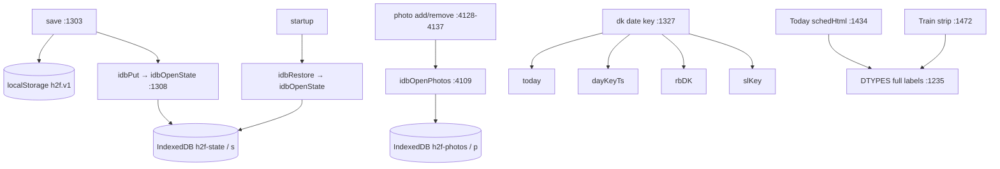

# Unified proposal

Simplest fixes first; deletion over abstraction.

1. **D1 → two distinctly named openers.** `idbOpenState()` (state, :1308) and `idbOpenPhotos()` (photos, :4109). Every call site renames: idbPut/idbRestore → `idbOpenState`; photo functions (phInit/phTx/phPut/phDelete/phSave/phRemove/phDeleteAll/refreshInfo, :4110–4137) → `idbOpenPhotos`. No capability lost; the state second copy starts working.
2. **D2 → one `dk(d)` helper** (`Date → 'YYYY-MM-DD'`) next to `monday` (:1327). `dayKeyTs(ts)=dk(new Date(ts))`, `today()=dk(new Date())`, `rbDK=dk`, `slKey(off)` builds the date then calls `dk`. Old names stay as one-line aliases to avoid touching ~100 call sites.
3. **D3 → Today strip uses full focus names.** Keep `schedHtml` (it shows done ticks and opens a day) but drop `DSHORT` and use `DTYPES`, matching `strip()`. A full merge isn't worth it; the label mismatch is the real cost.
4. D4–D6: no change now.

